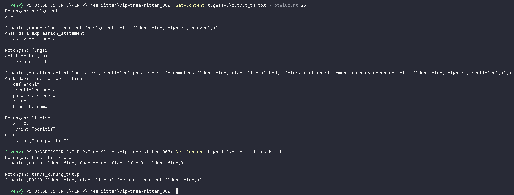
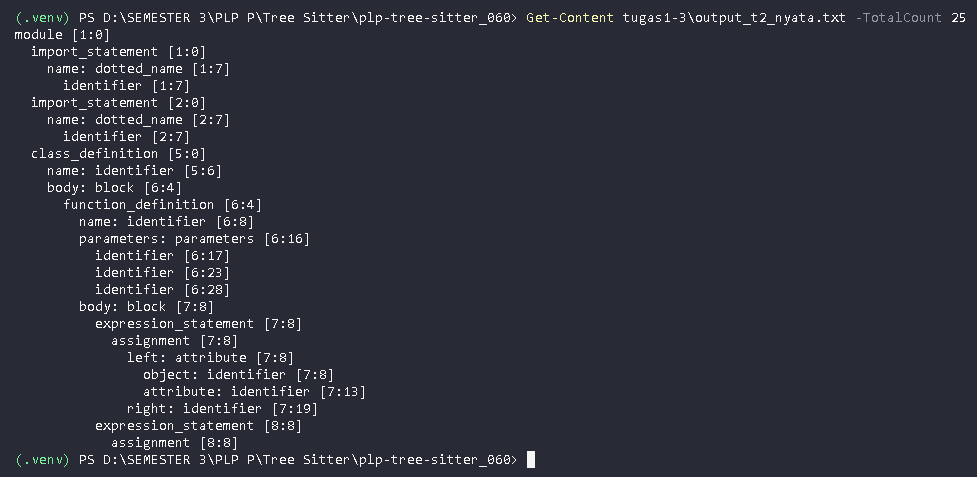
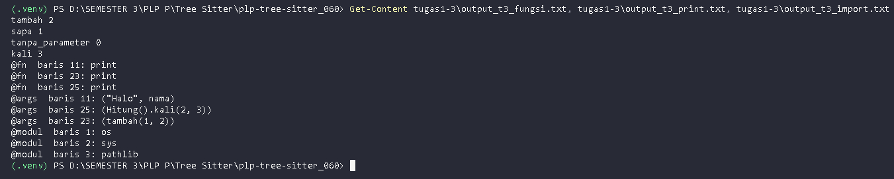
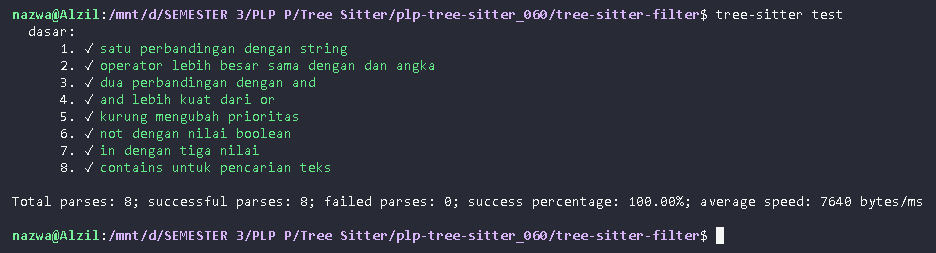
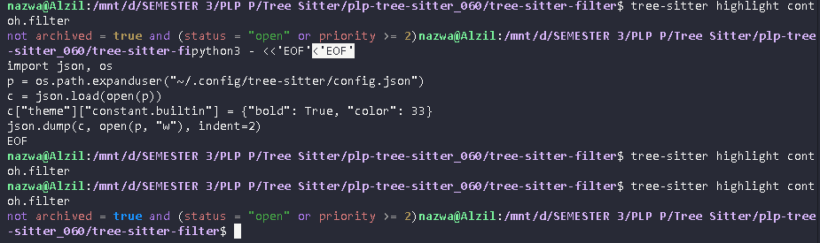
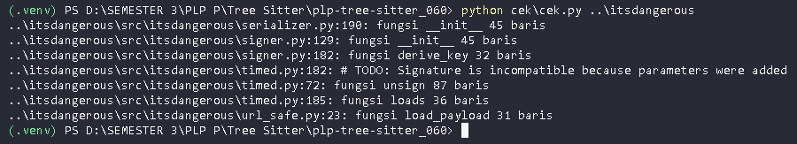

# Laporan Tugas Tree-sitter (Part 1)

Nama: Nazwa Rizqika Azzahra
NIM: 251524060
Repositori: https://github.com/pinksonnet/plp-tree-sitter_060

Lingkungan: Windows dengan WSL Ubuntu, Python venv (py-tree-sitter 0.26.1, tree-sitter-python 0.25.0), tree-sitter CLI 0.27.2 dengan Node.js 22.

## Tugas 1: Membaca pohon sintaks

Saya menulis tiga potongan kode Python (fungsi `tambah`, `if`/`else`, dan kelas `Mahasiswa` dengan satu method), menggambar perkiraan pohonnya dengan tangan, lalu membandingkannya dengan hasil `t1.py`. Struktur besar sudah benar, dengan tiga selisih:

1. `comparison_operator` tidak memiliki field `left` dan `right`. Isinya hanya `identifier` dan `integer` tanpa label, berbeda dari `binary_operator`.
2. `else_clause` memiliki field `body` yang berisi `block`.
3. `string` bukan node daun. Isinya `string_start`, `string_content`, dan `string_end`.

Pohon yang dihasilkan adalah Concrete Syntax Tree (CST), bukan AST, karena kata kunci dan tanda baca ikut menjadi node.

Node anonim yang ditemukan: `def`, `class`, `if`, `else`, `:`, `(`, `)`, dan `,`. Pada `function_definition` fungsi `tambah`, `children` berisi 5 node (`def`, `identifier`, `parameters`, `:`, `block`), sedangkan `named_children` hanya 3 (`identifier`, `parameters`, `block`). Selisihnya adalah dua node anonim.

Kode yang sengaja dirusak menghasilkan node `ERROR`. Tanpa `:` setelah `def sapa(nama)`, seluruh `def` masuk ke satu node `ERROR` dan tidak dikenali sebagai `function_definition`. Tanpa `)`, `ERROR` hanya menutupi baris `def`, sedangkan `return nama` tetap dikenali. Node `MISSING` tidak muncul pada kedua kode ini.

## Tugas 2: Penjelajah node rekursif

`jelajah.py` mencetak setiap node bernama dengan indentasi sesuai kedalaman, tipe, posisi `baris:kolom`, dan nama field. Nama field diambil dengan `field_name_for_child(i)` memakai indeks pada `node.children`, bukan `named_children`, karena indeks `named_children` bergeser dan membuat field salah. Node anonim dilewati dengan memeriksa `is_named`.

Pengujian dilakukan bertahap pada `kecil.py`, `t1.py`, lalu `contoh_nyata.py` (120 baris). Seluruh `class Mahasiswa` (160 node bernama) dibandingkan dengan Playground. Tipe, field, kedalaman, dan posisi awal cocok untuk semua node. Selisih satu-satunya adalah penomoran: Playground memulai baris dari 0, sedangkan `jelajah.py` mencetak `baris + 1`.

## Tugas 3: Query

Tiga query berjalan pada `uji_t3.py` dan hasilnya cocok dengan hitungan manual:

- `fungsi.scm` dengan `matches`: `tambah` 2 parameter, `sapa` 1, `tanpa_parameter` 0, `kali` 3 (parameter `self` ikut terhitung).
- `print.scm` dengan predikat `#eq?`: 3 pemanggilan `print` (baris 11, 23, 25). Pemanggilan `tambah` dan `sapa` tidak ikut.
- `import.scm`: 3 modul (`os`, `sys`, `pathlib`). Pohon `import` dilihat dulu dengan `jelajah.py` supaya nama node dan field tidak ditebak.

Query `import.scm` belum menangkap bentuk `import x as y` karena tidak ada di file uji dan tidak diminta.

## Tugas 4: Grammar DSL filter

Grammar dibangun bertahap dan setiap langkah disimpan sebagai kasus uji di `test/corpus/dasar.txt`: satu perbandingan, operator dan angka, `and`, `or` dengan prioritas, kurung, `not` dan boolean, label field, lalu `in` dan `contains`. Hasil akhir: 8 tes lulus, mencakup prioritas `and` di atas `or`, kurung, `not`, serta nilai string, angka, dan boolean.

Pada `or_expression` tanpa `prec` membuat `tree-sitter generate` gagal dengan pesan `Unresolved conflict` (`_expr 'or' _expr • 'or'`). Parser tidak tahu apakah `a or b or c` dikelompokkan dari kiri atau kanan. Perbaikannya `prec.left(1, ...)` untuk `or` dan `prec.left(2, ...)` untuk `and`: `prec.left` menyelesaikan rantai operator yang sama, sedangkan angka yang lebih besar mengikat lebih kuat antar-operator. Hasilnya `a = 1 or b = 2 and c = 3` terbaca sebagai `a = 1 or (b = 2 and c = 3)`.

## Tugas 5: Highlight

`queries/highlights.scm` memetakan `and or not in contains` ke `@keyword`, operator perbandingan ke `@operator`, `string` ke `@string`, `number` ke `@number`, `boolean` ke `@constant.builtin`, dan field di `comparison` serta `in_expression` ke `@property`. Entri `highlights` ditambahkan ke `tree-sitter.json` dan `parser-directories` diatur lewat `tree-sitter init-config`.

Pada tema bawaan, `@number` dan `@constant.builtin` berwarna sama sehingga `true` dan `2` tidak bisa dibedakan. Perbaikannya mengubah warna `constant.builtin` di `~/.config/tree-sitter/config.json` (di luar repositori) menjadi biru tebal. Setelah itu setiap jenis token berwarna berbeda.

## Tugas 6: Alat cek

`cek.py <folder>` memiliki tiga fitur: komentar `TODO`/`FIXME` (query dengan `#match?`), fungsi lebih dari 30 baris (`matches` dengan selisih `end_point` dan `start_point`), dan file dengan error sintaks (`has_error` dengan fungsi rekursif untuk baris pertama yang bermasalah). Pada folder `uji/` ketiga fitur melaporkan hasil yang diharapkan.

Diuji pada repositori `pallets/itsdangerous` (commit `672971d`). Hasilnya 1 komentar TODO (`timed.py:182`), 6 fungsi lebih dari 30 baris, dan tidak ada file dengan error sintaks. Pengecekan manual pada dua file: `timed.py` hanya memiliki satu komentar TODO (baris 182). Fungsi `unsign` mulai di baris 72 dan berakhir di baris 158 (87 baris), `loads` baris 185 sampai 220 (36 baris). Pada `signer.py`, `__init__` baris 129 sampai 173 (45 baris) dan `derive_key` baris 182 sampai 213 (32 baris). Semuanya sama dengan laporan `cek.py`.

## Kendala dan cara mengatasinya

| Kendala | Cara mengatasi |
| --- | --- |
| Aktivasi venv ditolak (`running scripts is disabled on this system`) | `Set-ExecutionPolicy -Scope Process -ExecutionPolicy Bypass`, lalu `Activate.ps1` |
| Node.js tidak ada di Windows, tree-sitter CLI butuh Node dan compiler C | Memakai WSL Ubuntu: `apt install build-essential nodejs npm`, lalu `npm install -g tree-sitter-cli` |
| `git status` di WSL menampilkan banyak file lama sebagai `modified` | Git hanya dijalankan dari PowerShell, `tree-sitter` dari Ubuntu |
| `tree-sitter generate` gagal: `module is not defined in ES module scope` | `package.json` hasil `tree-sitter init` berisi `"type": "module"`, jadi baris pertama `grammar.js` diubah ke `export default grammar({` |
| `Unresolved conflict` pada `or_expression` | `prec.left` dan tingkat prioritas (Tugas 4) |
| `true` dan angka berwarna sama pada highlight | Mengubah tema `constant.builtin` di konfigurasi CLI (Tugas 5) |

## Catatan penggunaan AI

Tugas dikerjakan dengan bantuan AI (Claude) sebagai pemandu langkah. Pembagian peran: AI memberi penjelasan, kode, dan perintah per langkah; saya menjalankan semuanya di komputer sendiri, menyiapkan lingkungan (venv, WSL Ubuntu, tree-sitter CLI), menyelesaikan kendala yang muncul, melakukan commit dan push bertahap, serta mencocokkan hasil dengan perkiraan, Playground, atau hitungan manual.

- **Tugas 1.** Diminta: kerangka `t1.py` dan `t1_rusak.py` serta penilaian perkiraan pohon. Kekurangan: perintah awal bergaya Linux (`source .venv/bin/activate`, `tee`) padahal saya memakai Windows PowerShell. Bukti: aktivasi venv ditolak dengan pesan execution policy; saya menggantinya dengan `Activate.ps1`, `Set-ExecutionPolicy`, dan `Out-File -Encoding utf8`.
- **Tugas 2.** Diminta: isi fungsi `jelajah()` dan file contoh 120 baris. Tidak ditemukan kesalahan. Saya memverifikasinya dengan membandingkan output dengan Playground.
- **Tugas 3.** Diminta: tiga query dan file uji. Kekurangan: urutan hasil yang ditulis AI untuk `nama_fungsi.scm` (baris 6, 14, 19, 10) berbeda dari hasil di laptop saya (baris 6, 10, 14, 19). Bukti: output `q.py`. Saya memeriksa isi dan jumlah hasil, bukan urutannya.
- **Tugas 4.** Diminta: grammar tiap langkah dan kasus uji. Dua kesalahan: (1) grammar memakai `module.exports` sehingga gagal pada proyek hasil `tree-sitter init` (bukti: pesan `ReferenceError: module is not defined in ES module scope`, saya perbaiki dengan `export default`); (2) AI menyatakan kasus uji lama harus diperbarui setelah label field ditambahkan, padahal tes tanpa label tetap lulus. Bukti: tes `coba tanpa label` (hasil yang diharapkan tanpa label field) tetap lulus pada `tree-sitter test`, dengan 9 dari 9 tes berhasil.
- **Tugas 5.** Diminta: isi `highlights.scm` dan konfigurasi CLI. Tidak ditemukan kesalahan pada kode yang diberikan. Saya memverifikasinya dengan `tree-sitter highlight` dan menemukan sendiri bahwa `true` dan angka berwarna sama pada tema bawaan.
- **Tugas 6.** Diminta: `cek.py`, file uji, dan README. Tidak ditemukan kesalahan pada kode yang diberikan. Saya memverifikasinya dengan pengecekan manual pada dua file dari repositori `itsdangerous`.